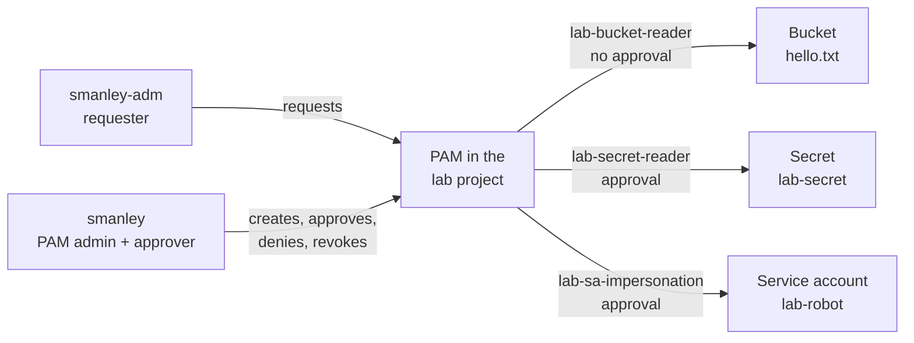
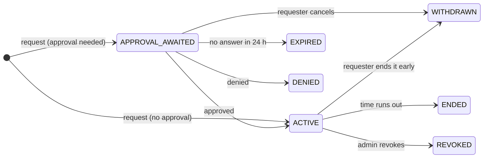

# Try PAM Yourself

A hands-on lab. You set up PAM in a throwaway project, then use it the way your team will: ask
for access, approve it, use it, and watch it go away. You play both people: **smanley-adm** asks for
access and **smanley** approves it. Updated 27 October 2026.
The other guides still use generic example accounts.

New to PAM? Read [HOW-PAM-WORKS.md](HOW-PAM-WORKS.md) first. This lab is the practical version.

- **Time:** about an hour. Much of it is waiting a couple of minutes for access to switch on or off.
- **Cost:** a small bucket, a secret, and API operations. Billing is required; charges depend
  on your billing account and free-tier eligibility. Clean up when finished.
- **Risk:** everything happens inside one new project. No organization-level IAM changes are needed.

**Contents**

1. [The lab at a glance](#the-lab-at-a-glance)
2. [Before you start](#before-you-start)
3. [Part 1: Build the lab project](#part-1-build-the-lab-project)
4. [Part 2: Turn on PAM for the project](#part-2-turn-on-pam-for-the-project)
5. [Part 3: Create the three entitlements](#part-3-create-the-three-entitlements)
6. [Exercise 1: Self-service access](#exercise-1-self-service-access-lab-bucket-reader)
7. [Exercise 2: Access with approval](#exercise-2-access-with-approval-lab-secret-reader)
8. [Exercise 3: Impersonating a service account](#exercise-3-impersonating-a-service-account-lab-sa-impersonation)
9. [Part 4: See the audit trail](#part-4-see-the-audit-trail)
10. [Clean up](#clean-up)
11. [From the lab to trekai.org](#from-the-lab-to-trekaiorg)
12. [Troubleshooting](#troubleshooting)

---

## The lab at a glance



You create three project-level entitlements, each a different kind of access. The data roles
apply to all matching resources in the lab project, so keep it dedicated to this test:

| Entitlement | Role it gives | Approval | What smanley-adm can do with it | Exercise |
|---|---|---|---|---|
| `lab-bucket-reader` | Storage Object Viewer (`roles/storage.objectViewer`) | None: self-service | Read files in the lab bucket | 1: self-service, end it early |
| `lab-secret-reader` | Secret Manager Secret Accessor (`roles/secretmanager.secretAccessor`) | smanley approves | Read the lab secret | 2: approval, let it run out |
| `lab-sa-impersonation` | Service Account Token Creator (`roles/iam.serviceAccountTokenCreator`) | smanley approves | Act as the `lab-robot` service account, which can upload to the bucket | 3: deny, approve, revoke |

Each entitlement allows grants of up to 1 hour. You'll ask for 30 minutes each time.

Exercise 3 matters most for you. It is the same pattern that replaces today's always-on access
to your admin service account.

**Who plays whom:**

- **smanley-adm** is the requester. smanley-adm has baseline project visibility,
  but no data access or impersonation rights except what PAM grants.
- **smanley** is the PAM admin (creates entitlements, revokes grants) and the approver.

> **Lab shortcut:** nobody can approve their own request. Here smanley approves smanley-adm's
> requests, which PAM allows because they are two separate accounts. In real use, approvers
> should be other people (see [safety rules](HOW-PAM-WORKS.md#8-safety-rules)).

### The grant states you'll see



| State | What it means | Where you'll see it |
|---|---|---|
| `APPROVAL_AWAITED` | Waiting for an approver | Exercises 2 and 3 |
| `ACTIVE` | Access is on | All three exercises |
| `WITHDRAWN` | The requester cancelled, or ended it early | Exercise 1 |
| `ENDED` | Time ran out, and PAM took the access back | Exercise 2 |
| `DENIED` | The approver said no | Exercise 3 |
| `REVOKED` | An admin ended it early | Exercise 3 |
| `EXPIRED` | Nobody answered within 24 hours | Optional, see [clean up](#clean-up) |

You may also catch short in-between states: `ACTIVATING`, `WITHDRAWING` and `REVOKING`.

---

## Before you start

You need:

- **Two accounts:** `smanley@trekai.org` sets up the lab and approves requests;
  `smanley-adm@trekai.org` requests access. The setup account matches your current gcloud
  configuration. The requester address assumes the same domain; change it below if needed.
- **Setup permissions:** being signed in does not grant administrative access. `smanley`
  needs Project Creator on the target organization or folder and Billing Account User on
  the billing account. Linking billing also needs project billing-management permission
  (normally available to the creator through project Owner). For an existing empty sandbox,
  ask its administrator for the permissions to enable APIs, create the lab resources, and
  manage project IAM and PAM. Skip project creation and billing linking if already done.
- **gcloud in bash or zsh:** your macOS Terminal works. Cloud Shell, Git Bash and WSL also
  work. These commands are not PowerShell syntax.
- **Two console sessions:** one signed in as smanley and one as smanley-adm. Separate browser
  profiles make it easier to keep them apart. Console sign-in is separate from gcloud login.
- **A requester without existing data or impersonation access:** smanley-adm must not inherit
  these permissions from the organization, folder, groups, or existing service-account IAM.
  Each exercise starts by checking this. Use an isolated sandbox or another test principal
  if the checks succeed before PAM; do not remove production permissions for this lab.

### Lab variables and discovery

In macOS zsh, enable pasted shell comments once per terminal before copying the blocks below:

```zsh
setopt interactivecomments
```

This prevents `zsh: command not found: #` when pasting comment lines. Skip this command in bash.

Start in your already authenticated terminal. These discovery commands do not change Cloud
resources:

```bash
gcloud config list
gcloud organizations list
gcloud billing accounts list
```

If billing discovery returns `Listed 0 items`, try your existing admin service account.
First, run this command to verify smanley can impersonate it. The token is discarded rather
than printed in your terminal:

```bash
ADMIN_SA=terraform-org-admin@trekai-452018.iam.gserviceaccount.com
gcloud auth print-access-token \
  --account=smanley@trekai.org \
  --impersonate-service-account="$ADMIN_SA" > /dev/null
```

If this fails with `iam.serviceAccounts.getAccessToken` denied, bootstrap smanley's access
using smanley-adm's existing administrative access:

1. Switch gcloud to smanley-adm and verify that account can impersonate the existing service
   account. If smanley-adm is not listed by `gcloud auth list`, first run
   `gcloud auth login smanley-adm@trekai.org`.

   ```bash
   ADMIN_SA=terraform-org-admin@trekai-452018.iam.gserviceaccount.com
   gcloud config set account smanley-adm@trekai.org
   gcloud auth print-access-token \
     --account=smanley-adm@trekai.org \
     --impersonate-service-account="$ADMIN_SA" > /dev/null
   ```

2. If that check succeeds, grant smanley Token Creator on this specific service account,
   using the impersonated service account's IAM administration permissions:

   ```bash
   gcloud iam service-accounts add-iam-policy-binding "$ADMIN_SA" \
     --project=trekai-452018 \
     --member="user:smanley@trekai.org" \
     --role="roles/iam.serviceAccountTokenCreator" \
     --condition=None \
     --account=smanley-adm@trekai.org \
     --impersonate-service-account="$ADMIN_SA"
   ```

   This requires the service account to have `iam.serviceAccounts.setIamPolicy` on itself.
   If the command is denied, have an administrator with that permission grant the binding.
   This binding gives smanley ongoing impersonation access to the existing admin service
   account; it does not expire with the lab's PAM grants or disappear when you delete the
   lab project. Remove the binding after testing if it was added only for this lab.

3. Switch back to smanley, allow a few minutes for IAM propagation, and verify:

   ```bash
   gcloud config set account smanley@trekai.org
   gcloud auth print-access-token \
     --account=smanley@trekai.org \
     --impersonate-service-account="$ADMIN_SA" > /dev/null
   ```

If the smanley check finishes without an error, impersonation worked. There is no separate
impersonation login session to start: include `--impersonate-service-account` on each command
that should act as the service account. Now list billing accounts using that identity:

```bash
gcloud billing accounts list \
  --account=smanley@trekai.org \
  --impersonate-service-account="$ADMIN_SA"
```

Use your existing admin service account, not `lab-robot` (which does not exist yet). smanley
needs Service Account Token Creator (`roles/iam.serviceAccountTokenCreator`) on that account,
and the service account needs permission to view the billing account. An impersonation error
means this prerequisite is not satisfied; a successful command with zero results means the
service account also cannot see any billing accounts.

Your earlier command used smanley-adm to impersonate this service account. For this setup,
the caller is smanley instead. Impersonation permission held by smanley-adm does not transfer
to smanley; an authorized administrator must grant smanley access if it is missing. Keep
smanley-adm's existing admin-service-account access separate from Exercise 3: that exercise
tests impersonation of the newly created `lab-robot`, not this existing service account.

Copy the desired account's `ACCOUNT_ID` into `BILLING_ACCOUNT` below. Discovering an ID does
not grant smanley permission to link billing. Part 1 includes an impersonated linking option.
These command-specific flags do not persist impersonation in your gcloud configuration.

Create `~/Documents/Google-Cloud/PAM/google-cloud-pam/PAM-LAB/.env` in your editor with the following contents. Replace the organization
and billing account placeholders and choose an unused, globally unique project ID:

```bash
ORG_ID=REPLACE_WITH_ORGANIZATION_ID
BILLING_ACCOUNT=REPLACE_WITH_BILLING_ACCOUNT_ID
PROJECT_ID=trekai-pam-lab-01    # choose an unused, globally unique project ID
APPROVER=smanley@trekai.org
REQUESTER=smanley-adm@trekai.org
BUCKET=${PROJECT_ID}-files
ROBOT_SA=lab-robot@${PROJECT_ID}.iam.gserviceaccount.com
# Existing service account for optional billing discovery/linking as smanley.
ADMIN_SA=terraform-org-admin@trekai-452018.iam.gserviceaccount.com
```

The `ADMIN_SA` value saves the existing service account for new terminals. Setting this
variable does not activate impersonation; only commands with the impersonation flag use it.

Create the directory first if needed with `mkdir -p ~/Documents/Google-Cloud/PAM/google-cloud-pam/PAM-LAB`. This file uses bash/zsh
assignment syntax: no spaces around `=`, and quote values containing spaces. Keep the lines
in this order so `BUCKET` and `ROBOT_SA` expand the project ID correctly. Store only lab
identifiers here, not passwords, tokens or service-account keys.

### After creating `.env`: save your configuration and load the variables

If you have already created `~/Documents/Google-Cloud/PAM/google-cloud-pam/PAM-LAB/.env`, continue here. Your uppercase `PAM-LAB` folder is inside
this repository at `/Users/smanley/Documents/Google-Cloud/PAM/google-cloud-pam/PAM-LAB`,
not directly in your home directory. The commands below use that actual location.

Before switching gcloud configurations, capture your original configuration **once** and save
it separately so cleanup also works from a new terminal:

```bash
mkdir -p ~/Documents/Google-Cloud/PAM/google-cloud-pam/PAM-LAB
if [ ! -f ~/Documents/Google-Cloud/PAM/google-cloud-pam/PAM-LAB/original-gcloud-config.txt ]; then
  gcloud config configurations list --filter=is_active:true --format='value(name)' \
    > ~/Documents/Google-Cloud/PAM/google-cloud-pam/PAM-LAB/original-gcloud-config.txt
fi
```

If you already switched to `pam-admin` or `pam-requester`, use
`gcloud config configurations list` to identify your original configuration and save its name
in that file instead. Do not overwrite it with a lab configuration name on subsequent runs.

Load the variables in your current terminal:

```bash
source ~/Documents/Google-Cloud/PAM/google-cloud-pam/PAM-LAB/.env
ORIGINAL_CONFIG=$(cat ~/Documents/Google-Cloud/PAM/google-cloud-pam/PAM-LAB/original-gcloud-config.txt)
cd ~/Documents/Google-Cloud/PAM/google-cloud-pam/PAM-LAB
```

Check the loaded identifiers before continuing:

```bash
printf 'Project: %s\nOrganization: %s\nBilling account: %s\nSetup/approver: %s\nRequester: %s\n' \
  "$PROJECT_ID" "$ORG_ID" "$BILLING_ACCOUNT" "$APPROVER" "$REQUESTER"
```

Make sure none are blank or still contain `REPLACE_WITH_` placeholders. Next, follow
[Two gcloud configurations](#two-gcloud-configurations), then
[Part 1: Build the lab project](#part-1-build-the-lab-project). You do not need to repeat
discovery or the impersonation bootstrap if you already completed them.

The project must belong to your organization. Setting `PROJECT_ID` does not create a project;
the first command in Part 1 creates it. If your organization requires a folder, obtain its ID
and use `--folder=FOLDER_ID` instead of `--organization="$ORG_ID"` in Part 1.

gcloud does not load `.env` automatically. Repeat the three commands in the loading block
whenever you open a new terminal. Switching gcloud configurations does not load or change
these variables. Keep the same project ID throughout the lab; after editing `.env`, source
it again. Only source your own trusted file, because `source` executes shell code.

### Two gcloud configurations

Create dedicated configurations so your existing configuration stays available. Use these
names only for this lab; if they already exist, inspect them and reuse only if appropriate.
`smanley` is already authenticated, so there is no need to log it in again:

```bash
# smanley: setup, PAM administrator and approver
gcloud config configurations create pam-admin
gcloud config set account "$APPROVER"
gcloud config set project "$PROJECT_ID"
gcloud config unset auth/impersonate_service_account

# smanley-adm: requester; choose this account in the browser login flow
gcloud config configurations create pam-requester
gcloud auth login "$REQUESTER"
gcloud config set account "$REQUESTER"
gcloud config set project "$PROJECT_ID"
gcloud config unset auth/impersonate_service_account

gcloud auth list
gcloud config configurations list
gcloud config configurations activate pam-admin
```

Expected result: both configurations exist, with `pam-admin` using smanley and
`pam-requester` using smanley-adm. The final command activates `pam-admin`; the account list
printed earlier may still mark smanley-adm as active because it ran before that switch.

When setting the project before Part 1, gcloud may warn that it does not exist or cannot be
accessed. If the project ID matches your `.env`, answer `y` to save the setting. This does
not create the project; Part 1 does. If you already completed this section, do not rerun the
configuration-creation commands.

Use your existing admin service account only for setup operations that need its permissions,
such as the optional billing discovery and linking commands. Keep impersonation scoped to
individual commands. All requester commands must run as smanley-adm directly. Check that
`CLOUDSDK_ACTIVE_CONFIG_NAME`, `CLOUDSDK_CORE_ACCOUNT`,
`CLOUDSDK_AUTH_IMPERSONATE_SERVICE_ACCOUNT`, `CLOUDSDK_AUTH_ACCESS_TOKEN`, and
`CLOUDSDK_AUTH_CREDENTIAL_FILE_OVERRIDE` are not overriding these configurations. Remove any
such overrides in your lab terminal before continuing. Application Default Credentials from
`gcloud auth application-default login` are not needed for these gcloud commands.

The blocks below switch configurations when the actor changes. Before a request or approval,
you can confirm the actor with `gcloud config list`.

---

## Part 1: Build the lab project

**Who:** smanley, impersonating the existing admin service account for every setup operation.
`APPROVER` must be `smanley@trekai.org`, and `ADMIN_SA` must be
`terraform-org-admin@trekai-452018.iam.gserviceaccount.com` in your loaded `.env`.
The requester account does not create resources or receive setup/admin roles.

Each command below uses `--account="$APPROVER" --impersonate-service-account="$ADMIN_SA"`.
This keeps smanley as the authenticated caller while using the service account's permissions
for the operation. No project Owner grant to smanley is needed. The impersonation applies
only to the commands that include the flag; later PAM administration runs directly as smanley.

In zsh, run `setopt interactivecomments` in this terminal before pasting blocks with `#`
comments. Otherwise a comment such as `(skip for an existing sandbox)` may produce
`zsh: unknown file attribute` instead of being ignored.

The admin service account needs Project Creator on the target organization or folder,
permissions to enable APIs, create the resources and manage project IAM, plus Billing Account
User (`roles/billing.user`) on the billing account and permission to assign project billing
(such as `roles/billing.projectManager`). Impersonation access alone does not grant these
permissions to the service account. If setup is denied, ask the administrator to check the
service account's permissions or provide an empty sandbox.

Run the steps in order and stop to resolve any errors before continuing. Skip creation if
you are using an existing sandbox, and skip billing linking if billing is already enabled.

```bash
gcloud config configurations activate pam-admin

# 1. Create the project (skip for an existing sandbox)
gcloud projects create "$PROJECT_ID" --organization="$ORG_ID" \
  --account="$APPROVER" --impersonate-service-account="$ADMIN_SA"

gcloud billing projects link "$PROJECT_ID" --billing-account="$BILLING_ACCOUNT" \
  --account="$APPROVER" --impersonate-service-account="$ADMIN_SA"

# Enable APIs even when using an existing sandbox
gcloud services enable privilegedaccessmanager.googleapis.com storage.googleapis.com \
  secretmanager.googleapis.com iam.googleapis.com iamcredentials.googleapis.com \
  --project="$PROJECT_ID" \
  --account="$APPROVER" --impersonate-service-account="$ADMIN_SA"

# 2. Something to read: a bucket with one file
echo "Hello from PAM" > hello.txt
gcloud storage buckets create gs://$BUCKET --project=$PROJECT_ID \
  --location=us-central1 --uniform-bucket-level-access \
  --account="$APPROVER" --impersonate-service-account="$ADMIN_SA"
gcloud storage cp hello.txt gs://$BUCKET/ \
  --account="$APPROVER" --impersonate-service-account="$ADMIN_SA"

# 3. Something secret, replicated in the allowed us-central1 location
printf 'The lab password is: pineapple' | gcloud secrets create lab-secret \
  --replication-policy=user-managed --locations=us-central1 \
  --data-file=- --project="$PROJECT_ID" \
  --account="$APPROVER" --impersonate-service-account="$ADMIN_SA"

# 4. A service account to impersonate. It stands in for your real admin SA:
#    it can upload to the bucket, which smanley-adm can't.
gcloud iam service-accounts create lab-robot --display-name="PAM lab robot" \
  --project="$PROJECT_ID" \
  --account="$APPROVER" --impersonate-service-account="$ADMIN_SA"
gcloud storage buckets add-iam-policy-binding gs://$BUCKET \
  --member="serviceAccount:$ROBOT_SA" --role="roles/storage.objectAdmin" \
  --account="$APPROVER" --impersonate-service-account="$ADMIN_SA"

# 5. Let both people see the project in the console (view only, no data)
for PERSON in $REQUESTER $APPROVER; do
  gcloud projects add-iam-policy-binding $PROJECT_ID \
    --member="user:$PERSON" --role="roles/browser" --condition=None \
    --account="$APPROVER" --impersonate-service-account="$ADMIN_SA"
done

# 6. Make smanley the PAM admin of this project only
for ROLE in roles/privilegedaccessmanager.admin roles/resourcemanager.projectIamAdmin \
            roles/logging.viewer; do
  gcloud projects add-iam-policy-binding $PROJECT_ID \
    --member="user:$APPROVER" --role="$ROLE" --condition=None \
    --account="$APPROVER" --impersonate-service-account="$ADMIN_SA"
done
```

Good to know:

- Each IAM command prints the project's whole policy. That's normal.
- If step 4 says the service account doesn't exist, wait 30 seconds and run that command again.
  New service accounts take a moment to appear.
- If your org keeps sandboxes in a folder, use `--folder=FOLDER_ID` instead of
  `--organization=$ORG_ID`.
- **Why smanley gets PAM Admin here:** in the real setup, these roles belong to the `pam-admin`
  service account or the Terraform pipeline ([HOW-PAM-WORKS.md](HOW-PAM-WORKS.md#4-setting-up-pam-with-an-impersonated-account)).
  Giving them to smanley on one throwaway project keeps the lab simple.

## Part 2: Turn on PAM for the project

**Who:** smanley, in the browser window signed in as smanley.

1. Open the [Privileged Access Manager page](https://console.cloud.google.com/iam-admin/pam/entitlements/)
   and pick the lab project in the project picker at the top.
2. If you see **Set up PAM**, click it, click **Grant role**, then click **Complete setup**. This
   lets Google's PAM service agent add and remove roles in the project.
3. If the entitlements page opens straight away, setup may already be satisfied through an
   inherited role. Verify onboarding for the selected project below. A lab-only setup grants
   the service-agent role on this project; do not grant it on the organization for this lab.

PAM uses the organization-level service agent
`service-org-ORG_ID@gcp-sa-pam.iam.gserviceaccount.com`, even for project entitlements.
The console handles setup; do not create a project-level PAM service account.
See [Google's setup instructions](https://docs.cloud.google.com/iam/docs/pam-permissions-and-setup).

Then check from gcloud. If it reports a problem, see [Troubleshooting](#troubleshooting).

```bash
gcloud config configurations activate pam-admin
gcloud pam check-onboarding-status --project=$PROJECT_ID --location=global
```

## Part 3: Create the three entitlements

**Who:** smanley.

### 3.1 In the console: `lab-bucket-reader`

Create the first one by hand, to see every option.

1. On the Privileged Access Manager page, with the lab project selected, open the
   **Entitlements** tab and click **Create**.
2. **Entitlement details:**
   - Entitlement name: `lab-bucket-reader`
   - Role: **Storage Object Viewer**
   - Maximum duration: **1 hour**
   - Click **Next**.
3. **Add requesters:**
   - Requester (use the value of `$REQUESTER` if you changed it): `smanley-adm@trekai.org`
   - Make requesters give a justification.
   - Click **Next**.
4. **Add approvers:** choose **Activate access without approvals**, then click **Next**.
5. Click **Create Entitlement**.

Alternatively, create the same entitlement entirely with gcloud (choose one method):

```bash
gcloud config configurations activate pam-admin
cat > lab-bucket-reader.yaml <<EOF
privilegedAccess:
  gcpIamAccess:
    resourceType: cloudresourcemanager.googleapis.com/Project
    resource: //cloudresourcemanager.googleapis.com/projects/$PROJECT_ID
    roleBindings:
    - role: roles/storage.objectViewer
maxRequestDuration: 3600s
eligibleUsers:
- principals:
  - user:$REQUESTER
requesterJustificationConfig:
  unstructured: {}
EOF
gcloud pam entitlements create lab-bucket-reader \
  --entitlement-file=lab-bucket-reader.yaml --location=global --project=$PROJECT_ID
```

Omitting `approvalWorkflow` makes this entitlement self-service.

### 3.2 With gcloud: `lab-secret-reader` and `lab-sa-impersonation`

The other two come from YAML files. This is how you'd script it. Terraform
([HOW-PAM-WORKS.md](HOW-PAM-WORKS.md#6-managing-pam-with-terraform)) does the same from a config
file.

```bash
gcloud config configurations activate pam-admin

cat > lab-secret-reader.yaml <<EOF
privilegedAccess:
  gcpIamAccess:
    resourceType: cloudresourcemanager.googleapis.com/Project
    resource: //cloudresourcemanager.googleapis.com/projects/$PROJECT_ID
    roleBindings:
    - role: roles/secretmanager.secretAccessor
maxRequestDuration: 3600s
eligibleUsers:
- principals:
  - user:$REQUESTER
approvalWorkflow:
  manualApprovals:
    requireApproverJustification: true
    steps:
    - approvalsNeeded: 1
      approvers:
      - principals:
        - user:$APPROVER
requesterJustificationConfig:
  unstructured: {}
EOF

# Same rules, different role
sed 's|roles/secretmanager.secretAccessor|roles/iam.serviceAccountTokenCreator|' \
  lab-secret-reader.yaml > lab-sa-impersonation.yaml

gcloud pam entitlements create lab-secret-reader \
  --entitlement-file=lab-secret-reader.yaml --location=global --project=$PROJECT_ID
gcloud pam entitlements create lab-sa-impersonation \
  --entitlement-file=lab-sa-impersonation.yaml --location=global --project=$PROJECT_ID
```

What the file says:

| Field | Meaning |
|---|---|
| `resource` | Where the role is granted: the lab project |
| `roleBindings` | The role a grant gives |
| `maxRequestDuration` | The longest grant allowed: 1 hour |
| `eligibleUsers` | Who can ask: smanley-adm |
| `approvalWorkflow` | Who approves (smanley), how many approvals are needed (1), and that the approver must give a reason |
| `requesterJustificationConfig` | The requester must give a reason |

> **Token Creator on a whole project** lets the holder act as *every* service account in that
> project. That's fine here, because it is a disposable project. Check that no sensitive service
> accounts are present; Google-managed service accounts may also exist. For your real admin
> SA, keep privileged service accounts in a project of their own, as `admin-sa-impersonation` in
> [`terraform.tfvars.example`](scripts/terraform/terraform.tfvars.example) does.

### 3.3 Check what smanley-adm can request

```bash
gcloud config configurations activate pam-requester
gcloud pam entitlements search --caller-access-type=grant-requester \
  --location=global --project=$PROJECT_ID \
  --format="table(name.basename():label=ENTITLEMENT, maxRequestDuration)"
```

All three should be listed. In smanley-adm's browser window, the same list is on the
**My entitlements** tab.

---

Use either the console or gcloud to create each request, not both. Save each returned grant ID
for approval, denial, withdrawal, revocation and inspection.

## Exercise 1: Self-service access (`lab-bucket-reader`)

**Goal:** get access with no approval, use it, then end it early when you're done.

**1. Prove smanley-adm has no access.**

```bash
gcloud config configurations activate pam-requester
gcloud storage cat gs://$BUCKET/hello.txt
```

Expected: a `403` error saying smanley-adm doesn't have `storage.objects.get` permission. If it prints
the file instead, smanley-adm already has access from somewhere else (see
[Troubleshooting](#troubleshooting)).

**2. Request access.**

- **Console** (smanley-adm's window): on the Privileged Access Manager page, open **My entitlements**,
  click **Request grant** in the `lab-bucket-reader` row, enter 30 minutes and the reason
  `PAM lab exercise 1: read hello.txt`, then click **Request grant**.
- **gcloud:**

  ```bash
  gcloud pam grants create --entitlement=lab-bucket-reader --requested-duration=1800s \
    --justification="PAM lab exercise 1: read hello.txt" \
    --location=global --project=$PROJECT_ID
  ```

**3. Check the state.**

```bash
gcloud pam grants search --entitlement=lab-bucket-reader --caller-relationship=had-created \
  --location=global --project=$PROJECT_ID \
  --format="table(name.basename():label=GRANT_ID, state, createTime)"
```

There is no approval step; wait for `ACTIVE` (you may first see `ACTIVATING`).
In the console, it's under
**Grants** → **My grants**.

**4. Use the access.** Wait about 2 minutes, because IAM changes take time to reach every Google
server (usually 2 minutes, sometimes 7 or more). Then:

```bash
gcloud storage cat gs://$BUCKET/hello.txt
```

Expected: `Hello from PAM`.

**5. End it early.** You're done, so give the access back instead of keeping it for the full
30 minutes.

- **Console:** **Grants** → **My grants** → **More options** (⋮) on the grant → **Withdraw**,
  then **Withdraw** again to confirm.
- **gcloud** (an alpha command; use the grant ID from step 3):

  ```bash
  gcloud alpha pam grants withdraw GRANT_ID --entitlement=lab-bucket-reader \
    --location=global --project=$PROJECT_ID
  ```

The state becomes `WITHDRAWN`. After a couple of minutes, the command from step 1 fails again.

**What you learned:** self-service entitlements give access at once, but it is still time-boxed
and logged. They suit low-risk roles that people need often.

## Exercise 2: Access with approval (`lab-secret-reader`)

**Goal:** request access, get it approved, look at what PAM changed in IAM, and let the time
run out.

**1. Prove smanley-adm has no access.**

```bash
gcloud config configurations activate pam-requester
gcloud secrets versions access latest --secret=lab-secret --project=$PROJECT_ID
```

Expected: a `PERMISSION_DENIED` error.

**2. Request access** in the console as in exercise 1, or with gcloud:

```bash
gcloud pam grants create --entitlement=lab-secret-reader --requested-duration=1800s \
  --justification="PAM lab exercise 2: read the lab secret" \
  --location=global --project=$PROJECT_ID
```

This time the state is `APPROVAL_AWAITED`. Nothing has changed in IAM yet: run step 1 again
and it still fails.

**3. Approve it, as smanley.** smanley gets an email from `pam-noreply@google.com`.

- **Console** (smanley's window): open the **Approve grants** tab, then **Pending approval**.
  Click **Approve/deny** on smanley-adm's request, write a reason in **Comment**, then click **Approve**.
- **gcloud:**

  ```bash
  gcloud config configurations activate pam-admin
  gcloud pam grants search --entitlement=lab-secret-reader --caller-relationship=can-approve \
    --location=global --project=$PROJECT_ID \
    --format="table(name.basename():label=GRANT_ID, requester, state)"
  gcloud pam grants approve GRANT_ID --entitlement=lab-secret-reader \
    --reason="Lab test, approved" --location=global --project=$PROJECT_ID
  ```

**4. Look under the hood.** Still as smanley, open the project's IAM policy:

```bash
gcloud config configurations activate pam-admin
gcloud projects get-iam-policy $PROJECT_ID --format=yaml
```

Find `roles/secretmanager.secretAccessor`. smanley-adm is on it, with a `condition` holding the end
time. That's all a grant is: an ordinary IAM role binding with an expiry, added by PAM's
service agent.

**5. Use the access.** As smanley-adm, after about 2 minutes:

```bash
gcloud config configurations activate pam-requester
gcloud secrets versions access latest --secret=lab-secret --project=$PROJECT_ID
```

Expected: `The lab password is: pineapple`.

**6. Let it run out.** Don't withdraw this one. Go on to exercise 3 and come back after the
30 minutes are up. The state is `ENDED`, the command from step 1 fails again, and the binding
is gone from the IAM policy. Nobody had to remember to remove it.

**What you learned:** approval is a gate that comes before any IAM change. Underneath, PAM only
adds an IAM binding with an expiry and removes it again.

## Exercise 3: Impersonating a service account (`lab-sa-impersonation`)

This is the pattern that replaces today's always-on access to your admin service account.
`lab-robot` stands in for that account.

**Goal:** see a request denied, then approved, then cut short by an admin.

**1. Prove smanley-adm can't act as lab-robot.**

```bash
gcloud config configurations activate pam-requester
echo "Uploaded by lab-robot" > robot.txt
gcloud storage cp robot.txt gs://$BUCKET/ --impersonate-service-account=$ROBOT_SA
```

Expected: an error about the `iam.serviceAccounts.getAccessToken` permission. smanley-adm isn't allowed
to act as the service account.

**2. Request access with a vague reason.**

```bash
gcloud pam grants create --entitlement=lab-sa-impersonation --requested-duration=1800s \
  --justification="need access" --location=global --project=$PROJECT_ID
```

**3. Deny it, as smanley.**

- **Console:** **Approve grants** → **Pending approval** → **Approve/deny**. Enter the comment
  `Please say what you need it for`, then click **Deny**.
- **gcloud:**

  ```bash
  gcloud config configurations activate pam-admin
  gcloud pam grants search --entitlement=lab-sa-impersonation --caller-relationship=can-approve \
    --location=global --project=$PROJECT_ID \
    --format="table(name.basename():label=GRANT_ID, requester, justification.unstructuredJustification)"
  gcloud pam grants deny GRANT_ID --entitlement=lab-sa-impersonation \
    --reason="Please say what you need it for" --location=global --project=$PROJECT_ID
  ```

The state is `DENIED`, and smanley-adm still has no access.

**4. Request again with a proper reason, and approve it.** As smanley-adm:

```bash
gcloud config configurations activate pam-requester
gcloud pam grants create --entitlement=lab-sa-impersonation --requested-duration=1800s \
  --justification="PAM lab exercise 3: upload robot.txt as lab-robot" \
  --location=global --project=$PROJECT_ID
```

Then approve it as smanley, the same way as exercise 2 step 3, with
`--entitlement=lab-sa-impersonation`. Use the **new** grant ID, not the denied one.

**5. Act as lab-robot.** As smanley-adm, after about 2 minutes:

```bash
gcloud config configurations activate pam-requester
gcloud storage cp robot.txt gs://$BUCKET/ --impersonate-service-account=$ROBOT_SA
gcloud storage ls gs://$BUCKET/ --impersonate-service-account=$ROBOT_SA
```

The upload works, and the listing shows `hello.txt` and `robot.txt`. PAM gave smanley-adm a single
role, Token Creator. Everything else came from what lab-robot is allowed to do. Your real admin
SA works the same way, which is why access to it deserves an approval step.

**6. Revoke it, as smanley.** Say the work finished early, or something looks wrong.

- **Console:** **Grants** → **Grants for all users** → **More options** (⋮) on the grant →
  **Revoke grant**.
- **gcloud:**

  ```bash
  gcloud config configurations activate pam-admin
  gcloud pam grants list --entitlement=lab-sa-impersonation \
    --location=global --project=$PROJECT_ID --filter="state=ACTIVE" \
    --format="table(name.basename():label=GRANT_ID, requester, state)"
  gcloud pam grants revoke GRANT_ID --entitlement=lab-sa-impersonation \
    --reason="Lab finished" --location=global --project=$PROJECT_ID
  ```

The state becomes `REVOKED`.

**7. Check, and learn about tokens.** As smanley-adm, after about 2 minutes, try another upload:

```bash
gcloud config configurations activate pam-requester
gcloud storage cp robot.txt gs://$BUCKET/robot2.txt --impersonate-service-account=$ROBOT_SA
```

This may still work, and that's not a bug. When smanley-adm acted as lab-robot, gcloud got an access
token for lab-robot, and that token stays valid for up to an hour. Revoking stops smanley-adm from
getting *new* tokens. It doesn't cancel tokens already handed out.

To prove that new tokens are refused, ask for one directly:

```bash
curl -s -X POST \
  -H "Authorization: Bearer $(gcloud auth print-access-token)" \
  -H "Content-Type: application/json" \
  -d '{"scope": ["https://www.googleapis.com/auth/cloud-platform"]}' \
  "https://iamcredentials.googleapis.com/v1/projects/-/serviceAccounts/$ROBOT_SA:generateAccessToken"
```

Expected: a response with `"status": "PERMISSION_DENIED"`.

**What you learned:** with impersonation, access can outlast the grant by up to an hour. Keep
these grants short, and remember that revoking doesn't instantly cut off someone who already
has a token.

---

## Part 4: See the audit trail

**Who:** smanley.

**One grant's history:**

```bash
gcloud config configurations activate pam-admin
gcloud pam grants list --entitlement=lab-sa-impersonation \
  --location=global --project=$PROJECT_ID \
  --format="table(name.basename():label=GRANT_ID, requester, state)"
gcloud pam grants describe GRANT_ID --entitlement=lab-sa-impersonation \
  --location=global --project=$PROJECT_ID --format="yaml(state, timeline)"
```

Replace `GRANT_ID` throughout this guide with the ID for the specific request you are testing;
it is the final segment of the grant name, not the entitlement name.

The timeline lists each event (`requested`, `approved`, `activated`, `revoked`) with its time.
The approve, deny and revoke events also say who did it and why.

**PAM activity in Cloud Audit Logs** (which entries appear depends on the audit-log
configuration and your log-viewing permissions):

```bash
gcloud logging read 'protoPayload.serviceName="privilegedaccessmanager.googleapis.com"' \
  --project=$PROJECT_ID --limit=30 \
  --format="table(timestamp, protoPayload.methodName, protoPayload.authenticationInfo.principalEmail)"
```

**PAM adding and removing roles**, which shows up as IAM policy changes made by the PAM service
agent:

```bash
gcloud logging read 'protoPayload.methodName="SetIamPolicy" AND protoPayload.authenticationInfo.principalEmail:"gcp-sa-pam"' \
  --project=$PROJECT_ID --limit=20 \
  --format="table(timestamp, protoPayload.authenticationInfo.principalEmail)"
```

In the console, paste the same filters into **Logs Explorer**. Approvers can also see a grant's
history in the **History** tab of the **Approve/deny** dialog.

---

## Clean up

**Optional, before you clean up:** to see `EXPIRED`, request `lab-secret-reader` once more,
leave it unanswered, and check the state the next day. Then clean up.

Only delete the project if you created it specifically for this lab. Do not delete a shared
or pre-existing project. As smanley (or the project administrator), review the target first:

```bash
source ~/Documents/Google-Cloud/PAM/google-cloud-pam/PAM-LAB/.env
ORIGINAL_CONFIG=$(cat ~/Documents/Google-Cloud/PAM/google-cloud-pam/PAM-LAB/original-gcloud-config.txt)
gcloud config configurations activate pam-admin
gcloud projects describe "$PROJECT_ID" --format="table(projectId,name,parent)"
# Confirm this is the disposable project you created, then accept the deletion prompt.
gcloud projects delete "$PROJECT_ID"

gcloud config configurations activate "$ORIGINAL_CONFIG"
gcloud config configurations delete pam-admin pam-requester
# Review ~/Documents/Google-Cloud/PAM/google-cloud-pam/PAM-LAB and remove only the local files you created for this lab.
```

A deleted project can be restored for 30 days, and its ID can't be used again.

If you used an existing sandbox project, **skip the project-deletion block above**.
Revoke active grants first, then delete the lab resources as smanley:

Do not remove pre-existing IAM bindings, disable shared APIs, or remove an inherited PAM
service-agent role. Record which bindings you added in Part 1 and remove only those afterward:

```bash
gcloud config configurations activate pam-admin
for E in lab-bucket-reader lab-secret-reader lab-sa-impersonation; do
  gcloud pam entitlements delete $E --location=global --project=$PROJECT_ID --quiet
done
gcloud storage rm -r gs://$BUCKET
gcloud secrets delete lab-secret --project=$PROJECT_ID --quiet
gcloud iam service-accounts delete $ROBOT_SA --project=$PROJECT_ID --quiet
```

---

## From the lab to trekai.org

| In the lab | In real life |
|---|---|
| `lab-robot` | Your admin service account |
| `lab-sa-impersonation` on the lab project | `admin-sa-impersonation` on a dedicated privileged-service-account project, following [`terraform.tfvars.example`](scripts/terraform/terraform.tfvars.example) |
| smanley approves smanley-adm | An approvers group of other people, such as `group:gcp-pam-approvers@trekai.org` |
| smanley is PAM admin of the project | The `pam-admin` service account, and later the Terraform pipeline |
| YAML files and `gcloud pam entitlements create` | Entries in `terraform.tfvars`, applied from GitHub |
| Checking states with `gcloud pam grants search` | Messages in `#pam-access` ([SLACK-NOTIFICATIONS.md](SLACK-NOTIFICATIONS.md)) |

The other guides and Terraform examples still contain `abcd.org` / `jdoe` placeholders;
substitute your actual organization, projects and principals when using them.

For example, `lab-secret-reader` as a Terraform entry in `scripts/terraform/terraform.tfvars`:

```hcl
"lab-secret-reader" = {
  parent               = "projects/trekai-pam-lab-01"
  roles                = [{ role = "roles/secretmanager.secretAccessor" }]
  eligible_principals  = ["user:smanley-adm@trekai.org"]
  approver_principals  = ["user:smanley@trekai.org"]
  max_request_duration = "3600s"
}
```

When you're ready for the real thing, follow the [rollout order](README.md#rollout-order) so you
can't lock yourself out.

## Troubleshooting

| Problem | What to do |
|---|---|
| Billing account discovery returns `Listed 0 items` | Try the optional impersonated discovery command in Lab variables and discovery. If that also returns zero items, ask the billing administrator for access or use a sandbox with billing already enabled. |
| Impersonated billing discovery or linking fails | Verify smanley can impersonate `ADMIN_SA`. The service account needs billing visibility for discovery, and billing-account plus project billing permissions for linking. |
| A "prove smanley-adm has no access" check already works | smanley-adm has the role from higher up, such as the org or a folder. Find where with **IAM & Admin → Policy Troubleshooter**, or do the lab with a test account that has no roles. |
| `gcloud projects create` fails | Follow Part 1's optional impersonated creation and project Owner grant for smanley, or use the required folder (`--folder=FOLDER_ID`). If the service account also lacks permission, ask for a sandbox project. |
| No **Set up PAM** button, or setup fails | Check Part 1 step 6 ran: smanley needs PAM Admin and Project IAM Admin on the lab project. Org deny policies or VPC Service Controls can also block the PAM service agent. |
| Creating an entitlement fails | Run `check-onboarding-status` (Part 2). PAM must be set up first. |
| The grant is `ACTIVE` but access is still denied | Wait. IAM changes usually take 2 minutes, sometimes 7 or more. |
| smanley can't see the request | Check that the lab project is selected and you're in smanley's window. The **Approve grants** tab only lists requests smanley can approve. |
| `gcloud alpha` isn't found | Run `gcloud components install alpha`, or withdraw in the console. |
| No emails arrive | Check spam, and ask IT to allow `pam-noreply@google.com`. |
| Impersonation still works after revoking | Expected for up to an hour. See exercise 3 step 7. |

## Sources

- [gcloud billing accounts list](https://docs.cloud.google.com/sdk/gcloud/reference/billing/accounts/list) (command-specific impersonation)
- [Authenticate to Cloud Billing](https://docs.cloud.google.com/billing/docs/authentication) (impersonation prerequisites)
- [Cloud Billing access control](https://docs.cloud.google.com/billing/docs/how-to/billing-access) (billing and project permissions)
- [Create entitlements](https://docs.cloud.google.com/iam/docs/pam-create-entitlements) (console steps, YAML format, 30 minutes to 7 days)
- [Request temporary elevated access](https://docs.cloud.google.com/iam/docs/pam-request-temporary-elevated-access)
- [Approve or deny grants](https://docs.cloud.google.com/iam/docs/pam-approve-deny-grants) (you can't approve your own request)
- [Withdraw grants](https://docs.cloud.google.com/iam/docs/pam-withdraw-grants) (pending, scheduled or active)
- [Revoke grants](https://docs.cloud.google.com/iam/docs/pam-revoke-grants)
- [Permissions and setup](https://docs.cloud.google.com/iam/docs/pam-permissions-and-setup) (project-level admin roles, Set up PAM)
- [PAM grant REST reference](https://docs.cloud.google.com/iam/docs/reference/pam/rest/v1/folders.locations.entitlements.grants) (states and timeline events)
- [Access change propagation](https://docs.cloud.google.com/iam/docs/access-change-propagation) (typically 2 minutes, potentially 7 or longer)
- [gcloud pam reference](https://docs.cloud.google.com/sdk/gcloud/reference/pam)
